<a href="#install">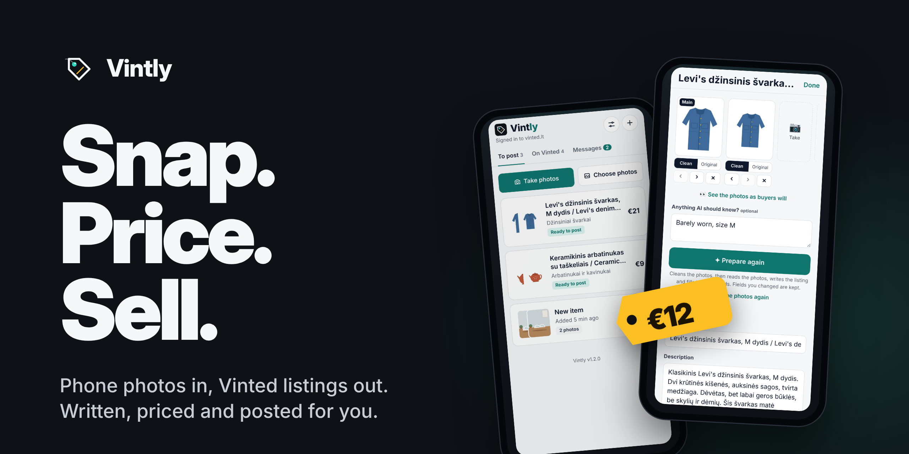</a>

<div align="center">

### Turn the pile you no longer need into money.

Photograph it. Check the price. Tap **Post**.<br>Vintly sorts the photos into items, cleans them, writes each listing, fills every Vinted field and suggests a fair price.

<a href="#install"></a>&nbsp;&nbsp;<a href="CHANGELOG.md"></a>

<sub>Free and open source, for iPhone and iPad, inside the free Scriptable app. One file, no server, no sign-up. Bring your own Claude or OpenAI key.</sub>

[](CHANGELOG.md)
[](https://apps.apple.com/app/scriptable/id1405459188)
[](#ai)
[](docs/BLUEPRINTS.md)
[](https://github.com/gadominas/Vintly/commits)
[](LICENSE)

</div>

<p align="center">
  <a href="docs/media/intro.mp4">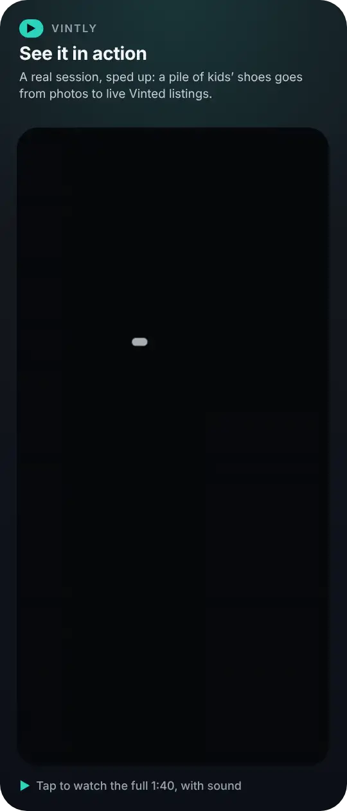</a>
  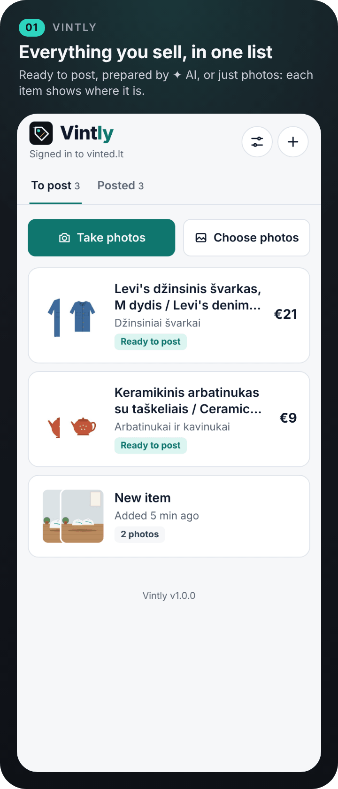
  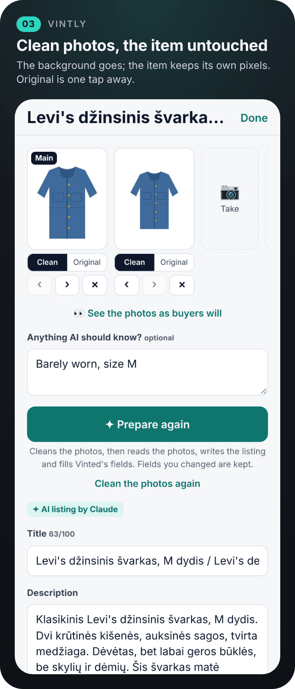
</p>
<p align="center"><a href="docs/media/intro.mp4"><b>▶ Watch the full intro</b></a> (1 min 40 s, with sound)</p>

> [!NOTE]
> Screenshots are rendered from the app's real interface with invented sample data. The items and their photos are drawn, not photographed. The video is a real session.

> [!IMPORTANT]
> **Unofficial.** Not affiliated with, endorsed by or connected to Vinted. Vintly uses the same web requests as Vinted's own website, signed in as you, which Vinted's terms may not allow and which can change without notice. Use it with your own account and at your own risk. See [Disclaimer](#disclaimer).

## Highlights

- **Photos to items.** Take or pick photos of several things at once; AI sorts them into items, and you can move a photo with two taps.
- **Clean backgrounds.** An OpenAI image model outlines the item and Vintly cuts your own photo along it onto white, so the item stays exactly as photographed, including everything inside its outline (a screen, a print, dark parts). Or let the model redraw a studio photo (Vinted is told it's AI).
- **Listings written for you.** Title, description, brand, condition and colours from the photos and your notes, in Lithuanian, English or another Vinted language, with a second language for buyers from abroad and a little humour if you like.
- **Technical details, looked up.** ✦ AI finds the exact product on the web (or by its barcode or ISBN in free product databases) and adds its dimensions, weight, materials and specs at the end of the description.
- **Every Vinted field filled.** Category, size, material and the other fields the category asks for, matched against Vinted's own lists, plus the parcel size.
- **A fair price.** Starts from Vinted's own price suggestion for the item, or the AI's used price, and goes a set share below it, rounded.
- **A pile at once.** Photograph several things; they're prepared two at a time while you wait or carry on, and posts go to Vinted one by one. Every card shows what's wrong with it (⚠) or that it's ready (✓).
- **You post.** Adjust the price with − and + and tap **Post** right on the list (3 seconds to undo), or open the item, change any field and post from there; or save a Vinted draft to finish on the website.
- **Your Vinted messages.** Every time Vintly opens it loads your conversations; the unread count leads the Messages tab and the widget. Read a conversation and reply without leaving Vintly.
- **Your listings, with delete.** All your Vinted listings, also those posted from the website, with views, favourites, sold and reserved. Open one on Vinted, or delete it with two taps.
- **Stickers and a QR code.** Fun stickers around the item (never over it) catch kids' eyes, and a small Vintly QR code on the main photo leads parents to this page. Preview them before you post, or turn them off.
- **Share sheet.** Share photos from Photos straight into Vintly.
- **Home Screen widget** with your unread Vinted messages and items waiting, a **launch screen**, **settings** with colours, layout and every limit, your own **AI key** with token usage, and **in-app updates**.

## Screenshots

<p align="center">
  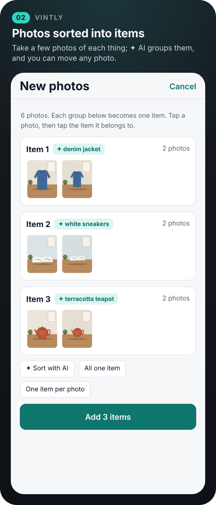
  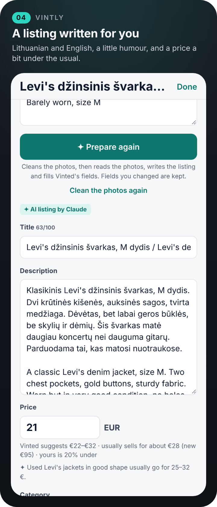
  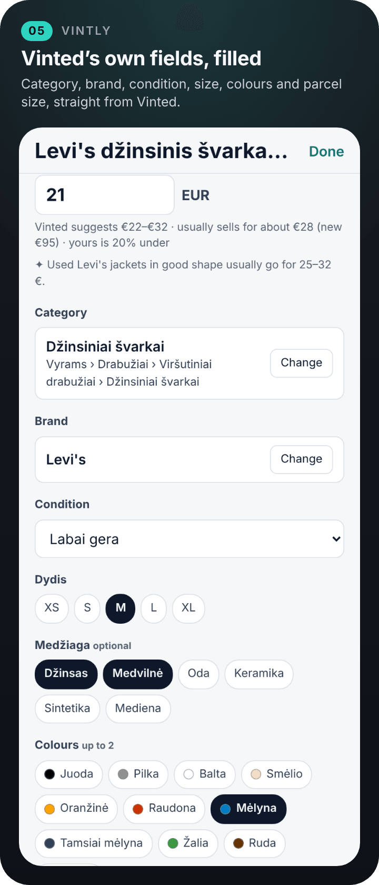
</p>
<p align="center">
  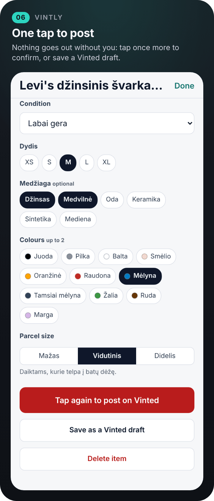
  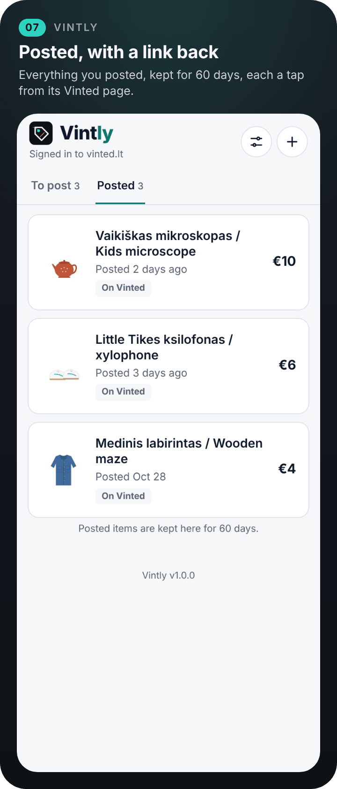
  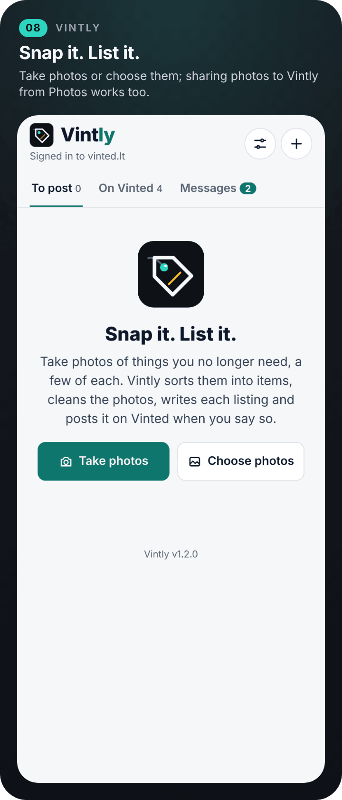
</p>
<p align="center">
  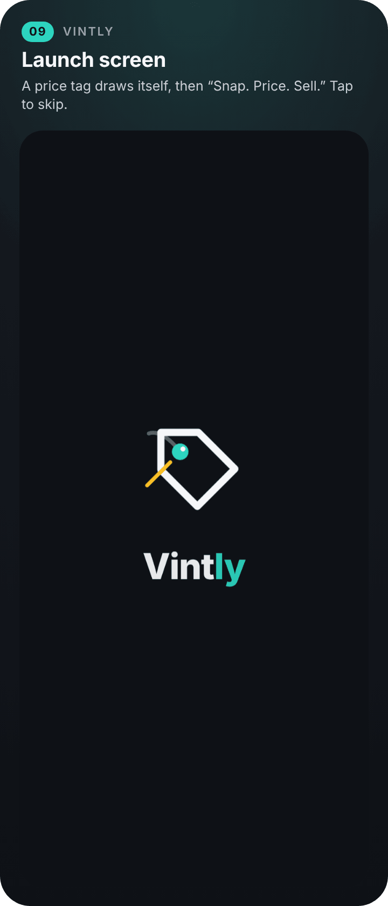
  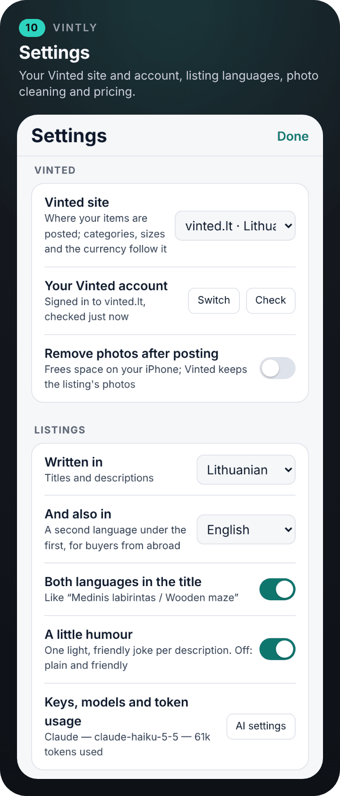
  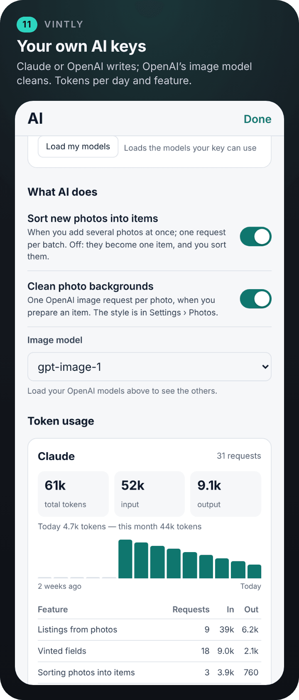
</p>
<p align="center">
  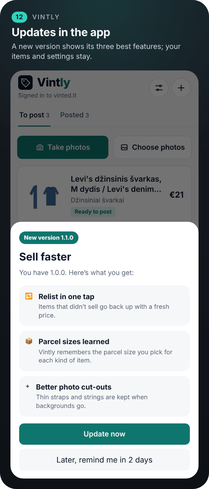
  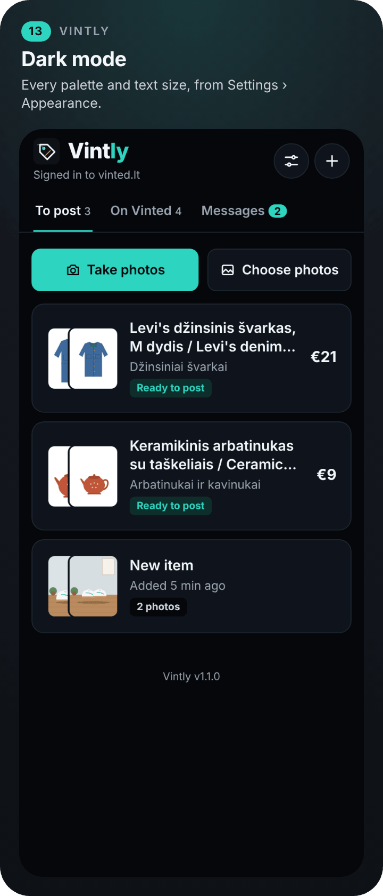
  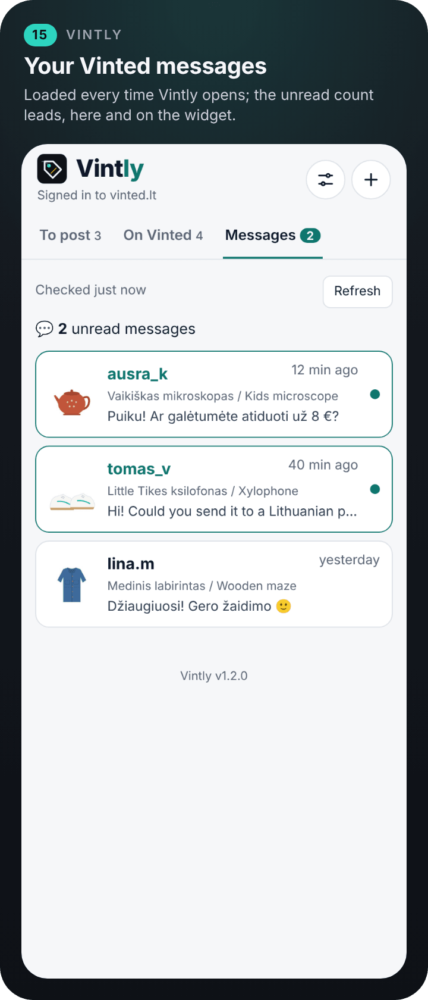
</p>
<p align="center">
  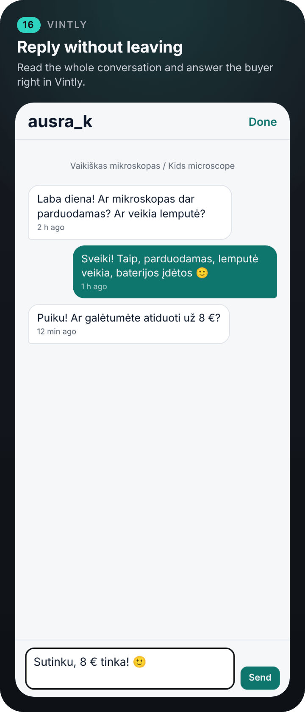
  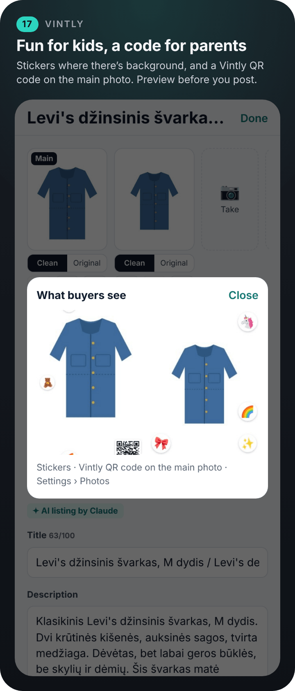
</p>
<p align="center">
  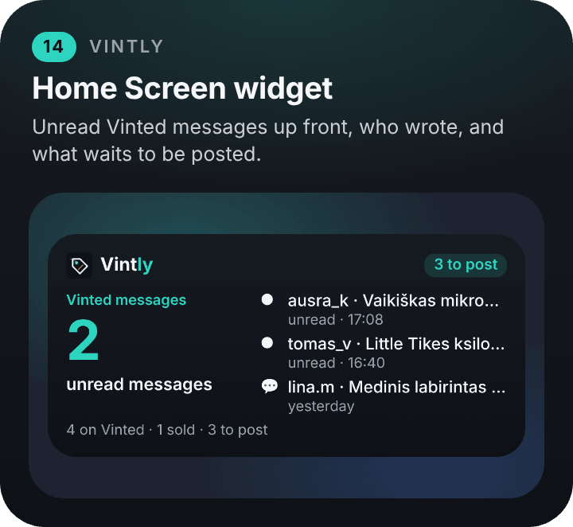
</p>

## Install

1. Get **[Scriptable](https://apps.apple.com/app/scriptable/id1405459188)** (free) on your iPhone or iPad.
2. In Scriptable, tap **+**, paste these two lines, name the script *Vintly Installer*, and tap **▶**:
   ```js
   const code = await new Request("https://raw.githubusercontent.com/gadominas/Vintly/main/install.js").loadString();
   await eval("(async () => {" + code + "\n})()");
   ```
3. Tap **Open Vintly**. Sign in to Vinted when Vintly asks, then add a Claude or OpenAI key in Settings › AI settings for listings written from your photos.

To update, tap **Update now** when Vintly offers a new version, or run *Vintly Installer* again. Your items, photos and settings are kept.

<details>
<summary><b>Install by hand</b></summary>

Rather not use the loader? Paste [`install.js`](install.js) or [`Vintly.js`](Vintly.js) into a new script in Scriptable yourself.

</details>

What else you need:

- A **Vinted account**. Sign in with e-mail, Apple or Facebook: Google doesn't allow signing in inside apps. If your account only uses Google, set a password on Vinted first.
- An **OpenAI key** for cleaning photos (image models are OpenAI only). A **Claude or OpenAI key** for sorting and writing listings; one OpenAI key does both.
- To share photos into Vintly: in Scriptable, open Vintly's settings (ⓘ) and turn on **Share Sheet Inputs › Images**. Vintly's script comes with it on.

## How to use it

| To… | Do this |
| --- | --- |
| Add items | Tap **Take photos** or **Choose photos**; take a few photos of each thing. Or share photos to Vintly from Photos |
| See a photo large | Tap it: in the camera tray, in New photos or in an item. Swipe or ‹ › for the others; **Remove this photo** (two taps) takes it out |
| Fix the sorting | Tap a photo, then **→ Item 2** (or **＋ A new item**) in the viewer. **All one item** and **One item per photo** do it in one go. Tap **Add … items** |
| Get listings for a pile | After **Add … items**, each item is prepared in turn (the bar above the list shows how far; **Stop** ends the line). **✦ Prepare all** prepares items that weren't. Turn it off in Settings › AI settings › Prepare new items right away |
| Get a barcode read | Take one sharp close-up with the barcode filling most of the photo. Vintly scans the stripes, zooms in where ✦ AI saw it, and only uses digits whose check digit is right |
| Report a crash | Settings › Diagnostics › **Copy the log**, then paste it into a message. After a crash, the next start offers the same on the To post list. Turn **Detailed log** off once the problem is found |
| Fix an error | Errors are in plain words, on the card and by the button that failed. Tap **✦ Fix with AI**: AI changes what Vinted didn't accept (or fills what's missing) and lists the changes; then post again. Vinted's own answer is under **Details** |
| Post from the list | A ready card (✓) has the price with **−** and **+** (or type it) and **Post**; tap **Undo** within 3 seconds to stop it. A card with ⚠ says what's wrong; **Fix ›** opens it |
| Get a listing | Open an item, add notes if you know something the photos don't show (size, flaws, "never worn"), tap **Prepare**. Vintly cleans the photos, writes the listing, fills Vinted's fields and sets a price |
| Get the technical details | They're looked up while preparing and added at the end of the description. On the item, **Look up again** repeats it, **Add to the description** puts them in a description you wrote yourself, and the sources open in Safari |
| Change anything | Tap a field. Your changes stay when you prepare again |
| Choose photos | Under each photo pick **Clean** or **Original**, move it with **‹ ›**, or remove it |
| Post | Tap **Post on Vinted**, then tap again to confirm. **Save as a Vinted draft** sends it to your drafts instead |
| See what buyers get | **👀 See the photos as buyers will** under the photos shows them with the stickers and the QR code |
| Check for new messages | Pull the list down from the top and let go (or tap **Refresh**). Your listings update too |
| Answer a buyer | **Messages** (the number is how many are unread), tap a conversation, write, **Send**. Opening it marks it as read on Vinted |
| Delete a listing | **On Vinted**, tap the listing, **Delete from Vinted**, then tap again to confirm. It's gone on Vinted for good |

<details>
<summary><b>How the price is set</b></summary>

Vintly asks Vinted for its suggested price range for the item's category, brand and condition and takes the middle; if Vinted has none, it uses the AI's estimate of a usual used price. It then goes **Price below the usual** (20 %) under it, rounds to **Round prices to** (1) and never goes under **Lowest price** (2). All three are in Settings › Pricing.

</details>

<details>
<summary><b>The two ways of cleaning photos</b></summary>

- **Keep the item's pixels** (the default). The image model draws a black and white outline of the item; Vintly cuts your own photo along it, softens the edge, centres the item on white and keeps the photo's shape. Nothing on the item is redrawn.
- **Studio photo.** The image model redraws the whole photo on white. Tidier, but drawn by AI, so Vintly marks the listing as having AI photos, as Vinted asks.

**Original** under a cleaned photo switches back to your photo for that one.

Whatever lies inside the item's outline stays, even where the image model leaves it out: a screen, a print, a dark or shiny part.

</details>

<details>
<summary><b>Stickers and the QR code</b></summary>

Vintly draws them on the copies it sends to Vinted; the photos in Vintly stay as you took or cleaned them.

- **Stickers for kids** (Settings › Photos: All items, Kids' items, Off): three or four stickers such as ⭐ 🌈 🎈 🦄, in the places with the most background, never over the item when there's room.
- **Vintly QR code on the main photo** (on by default): a small white card in the emptiest corner that opens this page. When the item fills every corner, Vintly adds room under the photo for it.

> [!WARNING]
> Vinted's [catalogue rules](https://www.vinted.lt/catalog-rules) say listings must not link to other websites, and photos should show the item as it is. A QR code to GitHub can get a listing hidden; turn it off in Settings › Photos if you'd rather not take that risk.

</details>

## Widget

Your unread Vinted messages up front, who wrote last and about which item (never the messages themselves), how many listings you have on Vinted, and how many items wait to be posted. Before you sign in to Vinted, it shows items waiting and what you posted lately. It is the shared [widgets](https://github.com/gadominas/app-blueprints/blob/main/blueprints/widgets.md) blueprint, so all the apps' widgets look alike.

1. Long-press the Home Screen, tap **Edit › Add Widget**, choose **Scriptable** and a size.
2. Long-press the widget, tap **Edit Widget**, set **Script** to *Vintly* and **When Interacting** to *Run Script*.

Lock Screen widgets are added the same way under **Customize › Lock Screen**. The widget shows what Vintly saved the last time you used it, so it never signs in to Vinted itself: open Vintly to bring the message count up to date. A count older than a day says when it was checked.

## AI

AI sorts new photos into items, writes the title and description, picks the brand, condition, colours, category and Vinted's other fields from their lists, and estimates a used price. With your provider's web search it looks up the exact product's technical details (Claude's `web_search` tool or OpenAI's `web_search` in the Responses API; a few searches per item, billed by the provider on top of tokens). An OpenAI image model (`gpt-image-1` by default) outlines the item for cleaning.

- **Your own key.** Open **Settings › AI settings**, add a [Claude](https://console.anthropic.com/settings/keys) or [OpenAI](https://platform.openai.com/api-keys) key, pick any model the key can use and tap **Test connection**. **What AI does** turns sorting, the technical details lookup and cleaning on or off and picks the image model.
- **Kept safe.** The key is typed into a native iOS prompt, stored in the iOS Keychain and sent only to its own provider. The app's page never sees it.
- **You see the cost.** **AI settings › Token usage** shows tokens per day, feature and model. API use is billed by the provider, separately from any chat subscription.
- **Optional.** Without a key you group the photos yourself, they're posted as taken, and you write the listing; **Load Vinted's fields** still loads the category's fields and Vinted's price suggestion.

## Settings

Tap the sliders icon at the top. Changes apply at once and are saved in `settings.json` in iCloud Drive › Scriptable › Vintly, so updates never reset them.

| Section | What you can change |
| --- | --- |
| Appearance | Colours (Auto or six palettes), layout (Comfortable, Compact, Tiny), text size, headline font |
| Vinted | Vinted site (vinted.lt, .pl, .de, .fr and others), your account (sign in, switch, check), remove photos after posting |
| Listings | Language and a second language, both languages in the title, a little humour, AI settings |
| Photos | Cleaning: keep the item's pixels, studio photo or off; stickers for kids (all items, kids' items, off); Vintly QR code on the main photo |
| Privacy | Share anonymous usage, test the connection |
| Updates | Offer new versions, check now, start-up log |
| Pricing, Photos, AI, Vinted, Keeping items, Widget | How far below the usual price, rounding, lowest price; photo size, soft edge, room around the item, photos per item; photos AI looks at and their size; time limit for Vinted, category refresh, how often messages are checked; how long posted items stay; widget refresh, each with Reset |
| Built with | The shared blueprints this app follows, with links (read-only) |

## Updates and what's new

Vintly checks this repository for a new version each time it opens. When one is out, a sheet shows its three best features with **Update now** and **Later**; Later hides the offer for two days. Your data and settings are kept. Every release is in [CHANGELOG.md](CHANGELOG.md). Vinted can change its website at any time; when posting stops working, an update is the fix.

## Privacy and security

- Your items, photos and settings live in Vintly's folder in iCloud Drive › Scriptable (on the iPhone when iCloud Drive is off). Your Vinted sign-in is Scriptable's web session, like a browser's; Vintly never sees or stores your password.
- Photos go to your AI provider only when you tap **Prepare** or sort new photos, and to Vinted when you post. For the technical details, the item's name, printed text and barcode go to your AI provider, which searches the web; a barcode or ISBN alone goes to [Open Library](https://openlibrary.org) or [UPCitemdb](https://www.upcitemdb.com). Listings go to Vinted only when you tap **Post** or **Save draft**.
- Your Vinted messages and listings are read from Vinted inside Vintly and kept only on this iPhone, so they show at once next time. Message texts never go to AI, to the widget, or anywhere else; the widget shows who wrote and about which item.
- AI keys stay in the iOS Keychain and are only sent to their own provider.
- The update check only downloads `releases.json` from this repository.
- **Anonymous usage**, if you say yes when asked (or in Settings › Privacy), sends counts such as app opens, photos added, items prepared and posted, conversations opened and replies sent, with a random install ID, to [PostHog](https://posthog.com) (US cloud). Never your photos, titles, descriptions, prices, brands, messages or Vinted account. Turning it off deletes the ID. The events are listed in [docs/BLUEPRINTS.md](docs/BLUEPRINTS.md#usage-events-usage-analytics-step-4).

## How it works

Vintly talks to Vinted the way Vinted's website does: a hidden web view opens your Vinted site, signed in with Scriptable's cookies, and runs the requests from inside the page (photo upload, category and field lists, brands, colours, parcel sizes, price suggestions and posting; your listings and deleting one; your conversations, the unread count and replies). Category: Vinted's own guess from the first photo plus words from the listing, then AI picks from the matches. Cleaning sends each photo, letterboxed to the image model's size, to OpenAI's image edit endpoint and cuts the original along the returned outline in the page's canvas.

## Troubleshooting

| Problem | Try this |
| --- | --- |
| Not signed in to Vinted | Settings › Vinted › **Sign in**. Use e-mail, Apple or Facebook, not Google |
| Posting fails with a message from Vinted | The item shows each problem Vinted named, by field. Fix those and post again, or tap **Save as a Vinted draft** and finish on Vinted. **Copy the details** gives you everything Vinted answered, to send along if you need help |
| Photos aren't cleaned | Cleaning needs an OpenAI key that can use image models (OpenAI may ask you to verify your organisation for `gpt-image-1`) |
| A cut-out has a halo or misses a part | Pick **Original** under that photo, or **Clean the photos again**; **Soft edge around the item** is in Settings › Photos |
| Wrong category | Tap **Category** and search for the right one: the fields reload for it |
| Vintly stopped posting after working before | Vinted changed its website. Check for an update in Settings › Updates |
| The message count on the widget is old | The widget can't sign in to Vinted; open Vintly and it checks right away |
| A listing with the QR code was hidden by Vinted | Vinted doesn't allow links to other sites. Turn off **Vintly QR code on the main photo** in Settings › Photos and edit the listing's photos on Vinted |

## Built with

- **[Scriptable](https://scriptable.app)** by Simon Støvring: one JavaScript file, a WebView for the interface.
- **[app-blueprints](https://github.com/gadominas/app-blueprints)**: the shared in-app updates, settings, AI configuration, launch screen and widgets that every one of these apps uses, so they look and behave alike. **Settings › Built with** lists the versions; [docs/BLUEPRINTS.md](docs/BLUEPRINTS.md) adds the deviations.
- **[OpenAI image models](https://platform.openai.com/docs/guides/image-generation)** for outlining items, and **[Claude](https://www.anthropic.com/claude)** or **OpenAI** for writing listings.

Maintainers: release notes live in [`releases.json`](releases.json); see [docs/RELEASING.md](docs/RELEASING.md). Screenshots are regenerated with [repo-site](https://github.com/gadominas/app-blueprints/tree/main/repo-site) from [`docs/site/scenario.js`](docs/site/scenario.js); `tests/e2e.js` runs the whole flow in the emulator.

## Disclaimer

**Unofficial use of Vinted.** Vintly is not affiliated with, endorsed by or connected to Vinted UAB. It uses Vinted's website requests, signed in as you, which are not a public API: Vinted's terms may not allow automated listing, Vinted can change or block them at any time, and your account is your responsibility. Vintly never posts, replies or deletes without your tap. The optional QR code on photos links to this repository, which Vinted's catalogue rules don't allow; it is on by default only because its owner chose so, and you can turn it off. Check every listing before you post it: AI can get the brand, size, condition or price wrong.

A personal project, provided as is, without warranty. Vinted is a trademark of Vinted UAB. Claude is a trademark of Anthropic; OpenAI is a trademark of OpenAI.

## More apps like this

<p>
  <a href="https://github.com/gadominas/StravaFeed"></a>&nbsp;
  <a href="https://github.com/gadominas/BlogPulse"></a>&nbsp;
  <a href="https://github.com/gadominas/VisionX"></a>&nbsp;
  <a href="https://github.com/gadominas/Go2FGym"></a>&nbsp;
  <a href="https://github.com/gadominas/Tamo-"></a>&nbsp;
  <a href="https://github.com/gadominas/Reading-Stars"></a>
</p>

<sub>Strava Daily Digest · BlogPulse · VisionX · Go2FGym · Dienynas+ · Reading Stars, all single-file Scriptable apps built on the same blueprints.</sub>

## License

[MIT](LICENSE) © 2026 Gediminas Siutilas
